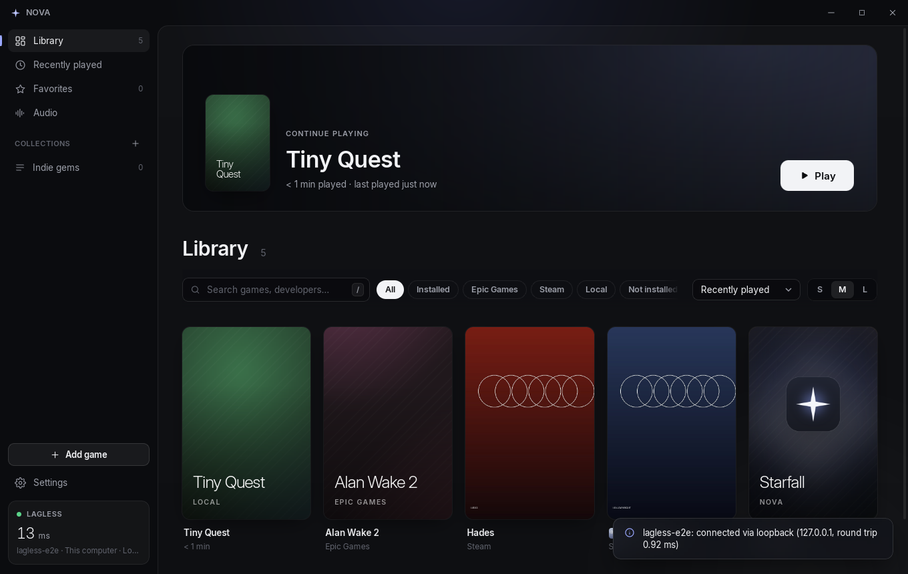

# Nova

A unified library and launcher for every PC game you own: Steam, Epic, GOG, portable games,
extracted ZIPs, anything with an `.exe`. Dark, quiet and fast, with **lagless built in**:
Nova streams your PC's audio to your Mac or phone and measures your games' FPS, all from
inside the same app.



## What it does

- **One library.** Steam, Epic Games and GOG installs are found automatically (read from the
  clients' own manifests, offline). Anything else is a folder import away.
- **Import a game folder.** Point Nova at a folder with hundreds of files and DLLs. It reads the
  executables' headers (nothing is run) and ranks them: the game first, then launchers, then
  tools, installers, crash reporters and redistributables. It recognises Unity, Unreal, Godot,
  Ren'Py, RPG Maker and GameMaker layouts, reads the developer from the exe's version info,
  and cleans up names like `Hollow_Sky.v1.4.2-GOG [Repack]` into "Hollow Sky".
- **Launches the way the game expects.** The exe starts in place, from its original folder,
  with the working directory set to the game's root folder (or a per-game or per-executable
  override), with optional launch arguments passed exactly as typed. Files are never moved.
- **Multiple executables per game** (DX11/DX12, launcher vs direct, editor). Pick which one
  Play uses; the others are in the Play menu. Change it any time if the first guess was wrong.
- **Knows when you're playing.** Nova tracks the process it started, every child in its Windows
  job object, and any process running from the game's folder. So launcher stubs that hand off
  to the real game, and store launches, are tracked correctly. Playtime and sessions are
  recorded automatically, and survive Nova being closed or crashing mid-game.
- **Library tools:** covers (Steam's cached art, your own images, or a generated typographic
  cover), favorites, collections, hide, search (title, developer, publisher), filters, sorting,
  three cover sizes, game icons (read from each executable or Steam's cache, never by running it), a "continue playing" hero, drag-and-drop import, keyboard shortcuts
  (`/` or `Ctrl+F` search, `Ctrl+N` add a game, `Esc` back).
- **Handles the messy cases:** missing executables, disconnected drives and unreadable folders
  show a clear state with a fix ("Locate folder" re-points the game and its executables),
  never a crash.

## lagless, built in

[lagless](https://github.com/leoble123/lagless) is linked into Nova as a Rust library and runs
in Nova's own process. There's no second window and no helper program: Nova's UI replaces
lagless's window entirely.

| lagless feature | In Nova |
|---|---|
| Ultra-low-latency PC → Mac/phone audio (sender engine) | Audio page and the sidebar widget: live latency, link, format |
| Volume, mute, pause | Audio page hero |
| Many receivers, per-device include, play in sync | Devices list, live without interrupting others |
| Mac mic → PC via VB-Cable | "Use the Mac's mic on this PC" |
| Game stats: FPS, 1%/0.1% lows, frame-time graph, stutter causes, GPU/CPU verdict | Audio page, **and on each game's page while it runs**; session average FPS goes into Activity |
| Click-through on-screen FPS counter | Transparent overlay window over borderless games |
| Room alerts from the Mac (doorbell, knock, alarm…) | Banner over the game + in-app notice |
| Settings (source, quality, loss protection, two links, low-latency Windows audio, follow Windows volume, OSD style) | Audio page |
| Control API for other apps (`control.json`) | Hosted by Nova, so tools that talk to lagless keep working |

Settings are shared with the standalone app (`%APPDATA%\Lagless\settings.json`). If the
standalone lagless app is already open, Nova doesn't start a second engine (two senders would
fight over the receivers); it drives the running app through its control API, and takes over
in-process as soon as that app is closed. The whole feature can be switched off in Settings.

## Safety

Imported folders and executables are treated as untrusted.

- Scanning and importing **never execute anything**. Executables are read as data (PE headers,
  version info, manifest).
- Games run with **your normal rights**. If a game demands administrator rights, Nova tells
  you and offers "Run as administrator" for that one launch; it never elevates on its own.
- Before a program runs, Nova checks it again and warns about disguised extensions
  (`cover.jpg.exe`), right-to-left-override names, files that claim to be `.exe` but aren't
  programs, scripts, DLLs, Windows system files, files in temp folders, hidden files, invalid
  Authenticode signatures, packers, admin-manifest programs, and keygen/crack-style names.
  Warnings are confirmed once per file version; a changed file asks again.
- Windows Defender and SmartScreen are never touched or bypassed.
- **Removing a game only deletes Nova's library entry.** No game file is ever deleted, moved or
  modified. Nova only writes inside its own data folder.

Basic functionality needs no internet connection. The only optional network feature,
downloading missing Steam artwork, is off by default.

## Architecture

```
Tauri 2 (WebView2 on Windows; ~10 MB app, no bundled browser)
├── src-tauri/src  (Rust)
│   ├── lib.rs        commands, app state, overlay windows, startup
│   ├── db.rs         SQLite library (WAL, migrations): games, executables, collections, sessions
│   ├── scanner.rs    folder inspection & executable ranking (read-only)
│   ├── pe.rs         PE header / version-info / manifest reader (never executes)
│   ├── safety.rs     warnings: disguises, signatures (WinVerifyTrust, offline), Mark-of-the-Web
│   ├── launcher.rs   launch plans, Job Objects, folder-based process tracking, playtime, recovery
│   ├── sources/      Steam (VDF), Epic (.item), GOG (registry)
│   ├── art.rs        cover cache in Nova's data folder
│   └── audio.rs      lagless hub: sender/mic engines, perf monitor, control API, external mode
└── src  (React + TypeScript)
    ├── views/        Library, GameDetails, ImportWizard, Audio, Settings
    ├── components/   covers, controls, menus, modals, icons
    └── overlay.tsx   FPS counter and alert overlay windows
```

Data lives in `%LOCALAPPDATA%\app.nova.launcher` (`library.db`, `art\`).

## Updates (OTA)

Nova updates itself. The source lives in a private repository, so builds are published to a
public, binaries-only repository (`leoble123/nova-releases`) that installed copies read from;
no token ships inside the app.

- Every few hours (and from Settings → Updates) Nova reads `latest.json` from the latest
  release, downloads the new `Nova.exe` in the background, and checks its SHA-256 **and** an
  Ed25519 signature over `nova-update\n<version>\n<sha256>` against the public key compiled
  into the app. Anything that doesn't verify is discarded.
- The verified exe is swapped in when Nova quits, or right away with **Restart to update**
  (running games keep running; time so far is saved). Works for the installed and the portable
  copy, without administrator rights. lagless's engine is part of Nova, so it updates too.
- Turn it off under Settings → Updates.

**Shipping a release:** bump `version` in `src-tauri/Cargo.toml` and push to `main`.
`.github/workflows/release.yml` builds, tests, signs (`tools/sign_update.py`) and publishes
`Nova.exe`, the installer and `latest.json` to the releases repository. It needs two secrets in
this repository: `NOVA_UPDATE_KEY` (the signing key) and `NOVA_RELEASES_TOKEN` (a fine-grained
token with *Contents: read and write* on `nova-releases` only).

**Rotating the signing key:** `python tools/sign_update.py --keygen`, put the public half in
`PUBLIC_KEY` in `src-tauri/src/update.rs` and the private half in the secret. Copies built with
the old key reject updates signed by the new one, so they need one manual download.

## Build

Requirements: Windows 10/11, [Rust](https://rustup.rs), Node 20+, CMake (for Opus, used by
lagless), and the WebView2 runtime (preinstalled on Windows 10 21H2+ and 11).

```bash
npm install
```

```bash
npx tauri dev
```

```bash
npx tauri build
```

`tauri build` produces `src-tauri\target\release\nova.exe` and an installer in
`src-tauri\target\release\bundle\nsis\`. The installer installs per-user (no admin prompt).
If CMake complains about the Opus sources, set `CMAKE_POLICY_VERSION_MINIMUM=3.5`.

Every push builds the installer on GitHub Actions (`.github/workflows/build.yml`).

## Tests

- `cargo test` in `src-tauri`: updater (valid update installs; tampered file, wrong signer and
  older versions are rejected; CI's signature format is accepted), database, scanner ranking on Unity/Unreal layouts, PE parsing
  and garbage input, safety checks, Steam/Epic parsing, title cleaning, launch planning, a real
  process launch with launcher hand-off and playtime, stop, crash recovery, lagless settings
  sharing.
- `e2e/run.mjs` drives the real app through WebDriver (`tauri-driver`) against a generated
  world (`e2e/fixtures.py`): store detection, folder import, a real launch with safety prompt
  and hand-off tracking, working-folder validation, search, collections, live lagless
  streaming to a real lagless receiver with game stats, removal leaving files intact, and
  persistence across restarts, and a full over-the-air update from a local signed feed (found,
  verified, running exe replaced, new version relaunched). Screenshots land in `docs/screenshots/`.
